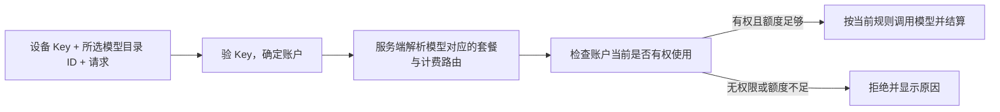

# Aino 桌面单设备单 Key、按调用计费方案

日期：2026-11-04。状态：按用户最新要求修订，供实施前评审。本次只写方案；批次 0 已提交 PR #26，新协议与计费适配尚未实施。

## 1. 核心原则

**每台设备只发一把永久 API Key。Key 只用于识别请求所属账户，不绑定套餐、计费分组、模型、价格或额度快照。每次调用，由服务端根据用户选择的模型和该账户的当前权限，确定计费方式并扣费。**

用户登录 Aino 桌面后直接选模型、聊天或生图，消费网站上同一账户的余额或订阅；日常无需复制 Key，也没有一小时到期、定时续期或每个聊天新建 Key 的流程。

Key 有必要的身份管理信息：归属账户、所属设备、密钥材料、启用/撤销状态和审计信息。“不绑定套餐”不表示删除这些信息，也不表示拥有无限调用权限。

## 2. 每次调用怎么处理

具体为：

1. **验 Key，确定是谁。** 服务端校验 Key 状态和账户状态，从 Key 得到账户身份；不采信客户端指定的消费用户。
2. **看本次选的模型，确定套餐。** 复用平台模型目录与 `DesktopModelService.ResolveForUser`，确定该选项的真实模型、计费分组、适用套餐、能力和费率。
3. **查当前权限并计费。** 检查该账户现在是否有对应套餐/分组权限、订阅是否有效、余额或额度是否足够，以及并发和限流。符合条件才调用，按已有规则扣费；不符合就拒绝，不自动换套餐或换付费模型。

这里“套餐”沿用 Aino-API 现有分组和订阅规则：余额型按对应组从账户余额扣费，订阅型按当前有效订阅及其额度处理。Key 本身不决定走哪一种。

### 同一个模型在多个套餐里

同名上游模型可能存在于多个套餐，不能只凭 `model: 某名称` 猜测收费。客户端发送用户实际选择的**平台模型目录 ID**，服务端查出这一选项的计费路由。名称相同但套餐不同的选项须能在现有模型选择 UI 中辨认，显示当前计费来源。

客户端不能自己填写价格、绕过套餐权限或任意指定计费组。所选选项不可用时返回明确原因；更换计费路线要由用户选择，不能静默 fallback 到其他收费组。

“每次现算”是每次使用当前生效的服务端授权和计费规则，不要求每次全量查库。沿用现有缓存和失效机制；余额扣减、订阅窗口、并发消费及最终结算继续使用现有账务实现。

已接受的单次请求使用确定的计费上下文；配置变更不能让同一请求中途换套餐或费率。展示价格与请求实际价格的生效规则沿用现有合同，付费请求不因超时自动重放。

## 3. Key 的生命周期

| 场景 | 行为 |
| --- | --- |
| 首次登录并启用模型 | 为该账户在本设备创建一把永久 Key |
| 新聊天、多窗口、项目/profile 切换 | 所有属于该账户的本地聊天复用同一把 Key；仍校验会话归属 |
| 切文本、生图、模型、套餐或购买新订阅 | Key 不变；下一次请求重新解析当前选择及权限 |
| 登录 token 刷新或到期 | 不轮换或撤销 Key；已配置模型可继续使用，管理操作按原登录机制恢复 |
| 关闭窗口、隐藏、正常重启 | 不撤销 Key；按原任务生命周期和记住登录设置恢复 |
| 主动退出/切换账户 | 停止本机使用原账户 Key，清绑定与本地材料；远端 Key 保留 |
| 网站停用/删除 Key，桌面撤销本设备 | 停止使用，不自动补发；用户明确重新授权才创建替代 Key |
| 余额不足、订阅到期、套餐权限变化 | 按当前规则拒绝或恢复；不生成另一把 Key |

设备作用域为 **平台站点 + 账户 + 桌面安装设备**，不含计费组、套餐、模型、用途或会话 ID。不同账户/站点隔离；不同设备各一把，可单独撤销。用户级额度、限流和并发仍在账户层共享，不能按设备重复分配。

同作用域保留稳定关联及唯一约束，避免多窗口或创建超时生成重复 Key。现有创建 `Idempotency-Key` 用于请求重试；服务端长期关联用于跨重启复用。名称只用于显示，不能当唯一身份。

主动停用、软删除后仍保留关联状态，不能过滤掉旧 Key 后把“查不到有效 Key”当作首次创建。重新登录本身不等于重新授权；明确重新授权后更新同一设备关联，原 Key 保持撤销、历史账单保留。

## 4. 保存、恢复和界面

Key 由 Electron 主进程管理，复用系统加密存储及现有私有 gateway 桥接；不进入 renderer、聊天、日志、普通配置文件或可导出的连接描述。账户管理 token 和 refresh token 继续留在主进程。

- 开启记住登录：加密保存并恢复原 Key，不因重启重新创建。
- 未开启记住登录：本次进程可在内存正常使用，不落盘；关闭该选项移除磁盘副本，退出进程或主动注销再清内存。
- 本地 Key 已清除：下次成功登录，服务端核对账户与设备关联后恢复原有效 Key。已停用/删除则显示需要明确重新授权，不自动补发。
- 清空应用数据可能产生新安装标识；旧设备授权保留在网站，用户可手动撤销。普通重启不得更换安装标识。

设备页显示设备名称、状态、最近使用及撤销操作；Key 期限显示“长期有效”。套餐、余额与订阅继续在原有账户/模型界面显示，不把 Key 包装成某个套餐的凭证。

普通退出说明“本机停止使用，授权仍可在设备页撤销”。撤销本设备同时停用该设备当前 Key，并兼容清理残留旧租约/登录族；不影响其他设备、手动 Key 或 BYOK。

登录管理状态和已配置模型状态在现有账户/模型 store 中区分。管理登录到期不再无条件清掉长期模型绑定；资料、充值、设备管理和恢复 Key 仍需有效登录。保留现有 Aino UI 风格和功能。

长期 Key 被复制后可使用到撤销或权限收回，这是实际取舍。通过设备隔离、系统加密、模型接口权限和用户可选限额控制影响，不宣称服务器加固消除了本机泄露风险。

## 5. 复用哪些代码，必须改哪些地方

### 5.1 直接复用

- 普通 API Key 已支持 `ExpiresAt = nil`，即永久有效；复用 `APIKeyService` 的创建、读取、停用、删除和审计能力。
- `DesktopModelService.ResolveForUser`、现有模型目录、分组授权、订阅、费率、模型转发、余额/额度、并发和限流。
- Key 鉴权 L1/L2 缓存、`APIKeyAuthSnapshot`、singleflight、`InvalidateAuthCacheByKey/ByUserID/ByGroupID`、`auth:cache:invalidate` 和 `auth_cache_invalidation_outbox`。
- 现有主进程账户管理、加密存储、gateway claim/ticket/revision 与会话归属检查。

### 5.2 最小适配

**现有 Key 通常绑定一个 `GroupID`，把它设空并不会自动得到按模型路由能力。** 新桌面模式需要明确的来源标记/设备元数据：Key 本身不保存固定套餐，API 在验出账户后，按本次平台模型目录 ID 生成请求级计费上下文，再进入原模型链。

目录解析必须发生在现有分组、订阅/余额检查和平台选择之前，否则未分组 Key 会先被错误地按余额路径处理。复用原鉴权链时构造请求内的 Key/组上下文副本，普通 Key 分支不变。目录 ID 需随模型请求实际抵达 API；仅给 SDK 设置真实模型名还不够，需在现有请求上下文增加可验证的目录标识。

`GroupID`、订阅、费率和允许模型属于**本次请求**，不得回写共享 Key 行或可变缓存对象。否则同一把 Key 并发调用两个套餐会互相覆盖。纯身份快照与按账户/目录/权限版本缓存的解析结果分清职责，仍复用现有服务和缓存，不建第二个钱包、模型代理或授权管理器。

普通用户手动 API Key 保持原固定分组语义；不把所有未分组 Key 都自动升级成跨套餐能力。新桌面 Key 能否调用某套餐始终由账户当前权限决定，也不能因此开放账户管理接口。

在现有 `api_keys` 上补最小设备关联和唯一约束，不增加独立设备授权实体、JWT 推理分支或影子计费 Key。新 Key 有真实密钥材料，实际用于 `/v1/*` 调用。

旧 `desktop_managed` 标记不可变，旧校验要求短期租约和父登录且拒绝空到期；因此需要明确区分新模式，保留旧行，不能仅修改到期字段或复用旧清理逻辑冒充完成。

### 5.3 gateway 长期绑定

当前 `expires_at` 必填，gateway 限制绑定有效期约一小时，到期还会中断任务。通过现有能力协商增加明确的长期形态，例如 `expires_at: null`，取消新路径逐会话云端租约和续期计时器；不能用极远日期或每小时推送模拟永久。

多个聊天引用同一个主进程 Key 来源，分别提交本次模型目录 ID，保留账户、连接、profile、会话、用途和迟到响应隔离。这些归属检查不能随租约一起删除。

旧 gateway/客户端继续原短租约模式，连接激活时固定协议；新路径失败不静默降级申请旧凭据，不重放付费请求。长流、停止、工具、子任务、压缩、生图/改图均完整回归，不改写历史消息或回合中系统提示/工具集合。

## 6. 计费、账单和缓存

### 6.1 真实 Key，一条账务链

账单仍关联真实 `usage_logs.api_key_id`。同一设备 Key 可以产生多个套餐/分组下的用量，**每条请求/用量记录必须保存实际 group、模型、费率和计费来源**，不能从 Key 当前分组反推历史。

现有用量已有独立 `group_id/subscription_id`，继续复用。异步生图的查询、内容读取和取消不一定携带目录 ID，应从已授权任务记录恢复原 group/platform，并核对任务 owner；不能按账户当前套餐重新选择路由或收费，也不能因生成后额度耗尽而丢失已付费结果的读取能力。

按 Key 汇总看到的是该设备总消费；套餐明细从用量记录读取。审查现有报表、筛选、导出、计费缓存与限流中“Key 固定一个 Group”的假设，必要处改读本次请求上下文，避免错账、跨组缓存污染或重复统计。旧账单及手动 Key 保持兼容，不重写历史。

### 6.2 缓存按权限失效，Key 不续期

身份快照缓存 Key owner、设备来源、启用/撤销及账户状态；模型解析投影缓存该账户对具体目录选项的权限、计费组和订阅资格。模型/组/套餐变化失效解析投影，不新建 Key；消费额度仍走现有结算，不冻结为登录时余额。

保留旧复核基线：余额型 **9 SQL + 1 Redis Lua**，订阅型 **11 SQL + 1 Lua**，分别统计。新永久模式取消旧租约与父登录复核；每次现算可命中有效投影，不要求每次跑完整目录查询，也不承诺所有冷请求零 SQL。

现有 ristretto L1 默认 15 秒，10% 抖动时最大 16.5 秒；Redis L2 默认 300 秒，前缀 `apikey:auth:*`。沿用 Key/User/Group 失效入口、广播与 DB outbox，补齐设备撤销、订阅、目录、价格和路由变更事件。

保持 **55 秒**健康环境撤销验收目标：最大 L1 16.5 秒 + outbox 健康 SLA 35 秒 + 3.5 秒传播预算。该值待多实例验证，不是现网保证。L2 回填不得刷新权威核验时间、让旧权限复活；失效链异常不得无限延长旧权限，截止前无法核验则拒绝新调用。

缓存数据新鲜度检查不是续期 Key：不修改 Key 到期、ID，不要求桌面定时申请。当前 `users` 表没有 `token_version` 列，`resolvedTokenVersion` 是身份派生值；登录 token 过期不代替本方案的真实 Key 撤销。

## 7. 分批实施与旧数据迁移

| 批次 | 内容 |
| --- | --- |
| **0：保留现有减负 PR** | PR #26：有效旧租约复用、目录 30 秒 TTL、生图明确禁用短路、旧续期 jitter/有界退避；与最终方案兼容 |
| **1：API 支持单 Key 动态计费** | 在现有 Key 数据补设备关联/唯一性，支持永久 Key；按目录 ID 解析请求级套餐/权限/计费上下文，接入原转发和账务；补报表与缓存兼容，旧客户端保持工作 |
| **2：本地桌面接入** | 每设备一把 Key 的创建/恢复/撤销，gateway 长期能力协商，取消新路径短租约续期；指定账户/设备灰度验收 |
| **3：远程兼容与旧链路收敛** | 本地经用户批准发布并稳定一个完整发布周期，且错误率/延迟不劣于基线、重复扣费为零、撤销与账单验收通过后启动；远程适配完成再扩大灰度，明确旧版本退役条件 |

一台设备从旧多个租约/分组 Key 迁移到一把新 Key，先幂等创建并验证当前权限与 gateway 能力，再切换；在途请求不重放。退役已迁移作用域旧租约，保留旧 Key ID、用量和审计；混用旧客户端仍需要的记录先兼容，不全量删除，不改已部署迁移。

回退按账户/连接受控切回旧链路，检查权限、撤销状态和在途结果。被撤销的设备不得自动恢复；不删新账单、不回滚余额，不因网络错误自动换 Key。

**远程边界单列，避免违背“单设备一把”。** 本方案的长期 Key 供所属设备的本地执行使用，不复制给远程 Agent。远程暂保留当前受限模式，功能完整保留；批次 3 优先评估复用现有主进程桥接代转发请求、让远程不接触长期 Key 的方式。该边界需单独设计与验收，不能为省事再给每个模型/套餐发永久 Key，也不能声称普通断开连接能使已复制的永久 Key 失效。

## 8. 验收标准

| 场景 | 通过条件 |
| --- | --- |
| 多聊天、多窗口、重启、100 次调用 | 同站点/账户/设备只有一把有效 Key；不随回合、模型、套餐、用途或 token 刷新增 Key/续期 |
| 同一 Key 并发调用不同套餐的文本与图片 | 每次独立校验、路由和计费，无共享 Group/订阅上下文覆盖、串账或缓存污染 |
| 异步生图查询、取消与结果读取 | 沿原任务 owner 和 group/platform 处理；套餐变更不串任务，已付费结果不因剩余额度不足而无法读取 |
| 购买/切换/到期套餐与余额充值 | Key 不变，后续请求使用当前规则；无权限或余额不足拒绝，恢复后复用原 Key |
| 同名模型存在多个套餐 | 按实际选择的目录 ID 明确计费，无客户端伪造 group/价格、无静默付费 fallback |
| 连续使用超过 24 小时 | 无小时 Key 到期、20 分钟续期或小时绑定刷新；管理登录到期不误停现有模型 |
| 普通退出/不记住登录 | 本次进程可正常内存调用；退出后清本地材料和绑定；远端 Key 保留，成功重登恢复同一有效 Key |
| 停用/删除/撤销本设备 | 健康默认配置下所有实例 55 秒内拒绝新调用；不自动补发，明确重新授权才替换，其他设备不受影响 |
| 创建超时或并发首次授权 | 原幂等操作和设备唯一关联恢复同一结果，不产生多把 Key |
| 余额/订阅、多设备并发 | 共用账户实际额度、订阅窗口、用户限流与并发，不按设备发放重复额度；余额/订阅热路径分开计数 |
| 账单、按 Key 汇总与套餐筛选 | 真实 Key 关联完整；每次实际 group/费率可追溯，跨套餐汇总准确；旧用量无损 |
| 功能与混合版本 | UI、流式、停止、工具、子任务、压缩、生图/改图、远程及 BYOK 完整；新旧能力兼容、回退不复活撤销 |

测试使用隔离 API/PostgreSQL/Redis 与受控模型替身，记录冷/热缓存、并发、批量重连和撤销补偿的请求次数、SQL/Lua、延迟、资源和重复扣费数，再据实给容量结论。

本次交付是方案修订，不自动启动后续协议实现、部署、合并或桌面发布。
