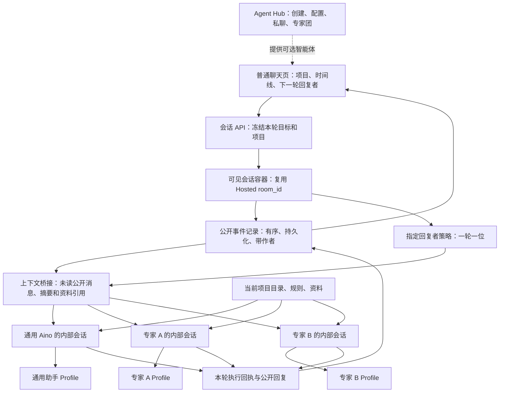

# Aino 同一会话使用多个智能体：已确认架构设计

日期：2026-09-20。状态：用户已确认方案，尚未实现。代码核对基线：`148c35ab27bd752b19e1e35273229d714ac57d4b`，包含当前工作区已有的导航调整。确认范围包含第 6.4 节的身份 / 作者上下文与第 8.1 节的自动子代理兼容要求。执行顺序与验收关卡见[实施计划](../plans/2026-09-20-aino-multi-agent-conversations.md)。

## 1. 目标与结论

用户在同一个可见会话内，可以依次使用 **通用 Aino → 专家 A → 专家 B → 通用 Aino → 专家 A**。会话标题、历史、所属项目、文件目录保持不变；选择器决定下一轮由谁回复。取消专家选择，回到通用助手，仍能接续此前的公开对话。

推荐实现：**一个公开会话容器，一份按顺序保存的公开时间线，每位参与者一份属于自己 Profile 的内部会话。** 服务端根据本轮明确选择的智能体，补齐其尚未接收的公开上下文，再调用其原有会话。Profile 继续保存人格、配置、技能和记忆，不再承担普通聊天页的全局导航切换职责。

底座优先复用仓库现有 Hosted Rooms 的持久化、顺序事件、执行账本、取消和恢复机制，新增具体的“指定本轮回复者”策略。现有群聊策略有不同的调度、上下文和生命周期约束，不能原样套用。

本方案没有把 WorkBuddy 的实现细节当作已知事实；截图和官方文档支持的是产品行为与概念。本文中的数据模型和内部会话设计是结合 Hermes 约束给 Aino 提出的实现方案。

## 2. 证据边界与概念校正

### 2.1 截图能确认什么（首批七张及补充三张）

截图显示 WorkBuddy v5.3.5 中，同一个名为“你好”的任务先后出现不同专家署名；移除专家后，回复署名回到 WorkBuddy；后续回复能够列举此前的用户问题。这支持“保留可见会话、逐轮选择专家、取消专家后继续”的目标。

不能据此确认它使用一个还是多个底层 session、是否热替换 system prompt、是否共享私人记忆、是否真的同时执行多个专家。截图中模型关于“system 切换 persona”“底层都是我”的自述，不是厂商的实现文档或运行证据。本期采用**逐轮选择、一轮一位回复者**；多人并行是另一项明确的团队功能。

补充三张图中，普通 WorkBuddy 回复不仅列出历史问题，还将其关联到“产品通”“美团生活助手”“TimeYes”等历史专家，并提到此前的回答内容。这增加了一条明确的体验要求：**当前回复者应能理解历史消息的作者及内容归属，而不只是收到一串无署名文字。** 截图中的列举是这次样例的输出，不证明每条归属都正确、原文全部完整可见，或能实时读取尚未发送的 UI 选择。

对补充图中的自述分别处理：

| 截图中的说法 | 本方案的处理 |
|---|---|
| 能识别此前参与的专家及其回答 | 补充为显式作者 / 本轮身份上下文与验收要求，见 6.4 |
| 取消专家后仍能谈论它的历史回答 | 保留公开记录和作者；取消选择不删除历史，也不改变本轮通用助手身份 |
| “同一个底层模型”“system 中 active expert = X” | 仅属模型自述；不据此变更 Aino 的独立内部 session 方案 |
| “工具能力不变” | 不能作为 Aino 契约；本项目各 Profile 可配置不同模型、工具、MCP 与权限，应执行各自真实配置 |
| “必须通过 UI，文字不能切换” | 截图未展示实际边界测试，不能当已证实的 WorkBuddy 限制；Aino 首期自行规定以结构化选择为路由依据 |
| 专家包含定位、方法论、模板、风格 | 可作为专家配置的内容参考；现有 SOUL / 技能 / 配置已承载此类内容，不需要据此增加运行子系统 |

### 2.2 应采用的产品概念

| 概念 | 用户用途 | 与其他概念的关系 |
|---|---|---|
| 项目 | 组织工作内容，如小说、自媒体；保存资料、规则、任务和产物 | 可包含多个普通会话，可使用多个智能体 |
| 普通会话 | 围绕一件事持续交流与执行 | 属于一个项目，或处于“未归属项目”；可有多个参与者 |
| 智能体 / 专家 | 决定谁执行本轮、采用什么人格和能力 | 可参加多个项目、多个会话；运行身份保留自己的 Profile |
| Profile | 智能体运行配置与状态的技术载体 | 保存独立配置、SOUL、记忆和内部 session；不是项目文件夹 |
| 通用 Aino | 未选择专家时的默认回复者 | 同样有一个明确的运行身份，默认绑定现有 default Profile |
| Agent Hub | 创建、配置、私聊、组建专家团 | 唯一的智能体管理入口；普通聊天页只提供选择入口 |

对前面讨论需要明确修正：

1. 取消普通聊天中的 Profile 切换，**不等于把所有智能体合并到一个“全局 Profile”**。统一的是会话入口、列表和任务记录，智能体的 Profile 仍然分别存在。
2. 普通会话不一定都有项目。已有代码支持没有项目的聊天；建议保留“未归属项目”，不要强制用户先建文件夹。
3. 同一项目可使用多个智能体；同一个智能体也可参加多个项目。因此，项目名与智能体名不应绑定。
4. 共享本会话的公开消息，不等于互相读取或复制私人 Bot Chat、SOUL 文件、密钥、长期记忆。智能体可能依据自己的记忆形成公开回复；一旦公开发表，其他参与者即可看到该回复。
5. 同一个 Profile 在不同项目中使用时，其长期记忆默认仍是该 Profile 的记忆。项目目录隔离不自动产生“按项目隔离的智能体记忆”，也不等于操作系统安全沙箱。
6. 普通聊天里的 `@Bot` 当前已有识别与提示注入，但不等于已实现这套多专家路由；临时 `delegate_task` 也不等于调用一个具有独立 Profile 的持久专家。

### 2.3 官方文档依据

本节与文末来源清单一起记录官方资料的可证实范围；后续实现以本仓实际调用链为准，官方最新文档不等于本仓所有功能都已完成。

| 官方证据 | 能支持的判断 | 不能据此推出 |
|---|---|---|
| WorkBuddy 专家中心：“专家是「角色切换」机制”，由“人设＋方法论＋工具链”构成 [W1] | 专家是任务中的能力 / 角色选择 | WorkBuddy 专家与 Hermes Profile 底层实现完全相同 |
| WorkBuddy 4.7.1：“对话窗口内支持通过选择器快速切换专家” [W5] | 普通对话内的专家选择是明确产品能力 | 一次选多个专家即可自动并行 |
| WorkBuddy 5.5.1：“修复移除专家后仍以专家口吻回答，以及首次使用专家时上下文偶尔未生效的问题” [W6] | 官方确有移除专家，并修复了首次使用专家时的上下文问题 | “上下文”具体是专家配置还是完整聊天历史；系统如何保存、复制和压缩它 |
| WorkBuddy 5.4.1 修复“切换模型或专家时任务中断”等问题 [W7] | 切换专家不应无故中断任务 | 可以无限长度逐字记住所有历史 |
| 专家团“由团长自动拆解、并行执行并整合交付”；在专家团会话中召唤其他专家须开新对话 [W1] | 专家团与普通专家选择是不同模式 | 把专家团的限制套用到全部普通会话 |
| WorkBuddy 项目组织指令、连接器、专家、技能和资料；“一个任务对应一个对话和一个工作空间” [W2–W4] | 项目、任务、工作目录、专家可以分开建模 | 工作目录等于专家身份 |
| Hermes：“every Bot is a Profile, but not every Profile is a Bot” [H1] | Profile 是配置和数据；Bot 是它在桌面名册中的呈现 | 创建项目就必须创建 Profile / Bot |
| Hermes 的 workspace/cwd 与 Profile 分开；Profile 不是文件访问沙箱 [H1] | 项目工作目录与专家身份可分别绑定 | 仅靠目录隔离保证隐私 / 文件权限隔离 |
| Hermes 的记忆快照 “captured once at session start and never changes mid-session” [H3] | 同一内部会话应维持稳定的记忆 / 系统前缀 | 每轮换专家时热替换同一个会话的 SOUL 和记忆 |
| Hermes 群聊是 “one visible conversation”，每成员保留 persistent room session，并使用 durable driver [H2] | 本方案有可复用的官方设计和仓库实现基础 | 普通会话选择 / 取消专家已经实现 |

本次还核对了 Hermes 委派文档：临时子智能体使用新会话，不自动继承父会话全部历史，也不等于一个永久独立 Profile。[H5] 普通 `@Bot` 文档写明身份提示与 `message_agent` 联络，同时限定工具在 canonical Bot Chat 中提供，因此应以实际代码限定其范围，不能称为已具备本方案的下一轮专家切换。[H2]

WorkBuddy 关于 `@` 的官方更新记录可证实专家 / 子助理的联想搜索，但本次没有找到普通任务内“一次 @ 多位专家即可自动轮流执行”的完整规范。[W5] 本方案的结构化 `@` 选择规则是 Aino 的设计决定。

Hermes 当前官网 / 上游 main 与本地部分文档有差异，例如新增的 Profile / Agent / Bot 释义及 Hosted driver 描述；本文将远端官方文档与本地代码分别引用，不把本地修改冒充上游事实，也不据最新文档假定本仓已具备全部能力。

## 3. 当前代码具备什么、缺什么

| 当前事实 | 代码依据 | 对方案的含义 |
|---|---|---|
| session owner 与 UI 当前浏览的 Profile 可以分开；请求已有精确 owner 路由 | [session-request-router.ts:5](/Users/zizimutou/Protect/Aino/apps/desktop/src/store/session-request-router.ts:5) | 选择专家不需要重新切换整套侧栏状态 |
| 创建会话时 `profile` 与 `cwd` 是独立参数；状态存入目标 Profile 的数据库 | [methods_session.py:341](/Users/zizimutou/Protect/Aino/tui_gateway/methods_session.py:341) | 各专家可以在同一项目目录执行，并保留各自运行身份 |
| 项目注册表目前按 Profile 保存，打开项目状态也带 Profile 作用域 | [projects_db.py:23](/Users/zizimutou/Protect/Aino/hermes_cli/projects_db.py:23)、[open-projects.ts:12](/Users/zizimutou/Protect/Aino/apps/desktop/src/store/open-projects.ts:12) | “All Profiles”浏览不等于已经有统一可写的项目管理 |
| 普通聊天 `@Bot` 中间件不直接投递，只附加使用 `message_agent` 的提示 | [plugin.tsx:690](/Users/zizimutou/Protect/Aino/apps/desktop/src/plugins/hermes-bots/plugin.tsx:690)、[plugin.tsx:810](/Users/zizimutou/Protect/Aino/apps/desktop/src/plugins/hermes-bots/plugin.tsx:810) | 需要结构化的本轮收件人字段，不能靠模型读文本猜路由 |
| Bot 私聊工具受 canonical Bot Chat 身份约束 | [bot_mode_dm.py:114](/Users/zizimutou/Protect/Aino/tools/bot_mode_dm.py:114) | 不应把普通项目会话冒充成 Bot Chat 来获得能力 |
| 临时子代理跳过长期记忆，但会加载项目上下文 | [delegate_tool.py:236](/Users/zizimutou/Protect/Aino/tools/delegate_tool.py:236)、[delegate_tool_progress.py:159](/Users/zizimutou/Protect/Aino/tools/delegate_tool_progress.py:159) | 适合临时分工；不能直接代替命名的持久专家 |
| 前端群聊已有共享记录、成员独立会话和增量传递 | [group-rounds.ts:27](/Users/zizimutou/Protect/Aino/apps/desktop/src/plugins/hermes-bots/group-rounds.ts:27) | 可借鉴交互与上下文标注；不能让普通会话的唯一记录只存在前端 |
| 后端 Hosted Rooms 已有容器及有序、可去重的事件表 | [hosted_rooms.py:88](/Users/zizimutou/Protect/Aino/gateway/hosted_rooms.py:88) | 不需要新造平行的通用任务数据库 |
| 跨 Profile 的协调数据已在 `shared-state.db` | [hosted_rooms.py:398](/Users/zizimutou/Protect/Aino/gateway/hosted_rooms.py:398) | 公共记录有服务端归属，不并入任一专家的私有状态库 |
| 执行层已有 admission、lease、execution generation、terminal receipt | [hosted_room_driver.py:582](/Users/zizimutou/Protect/Aino/gateway/hosted_room_driver.py:582) | 复用取消、恢复和幂等机制，新增选择专家的具体执行策略 |

以下是必须改造的差距，不是“加一个下拉框”就能完成：

- Hosted Discussion 的用户事件目前只接收 `text/thread_id`，调度会考虑提及及多人轮次；没有本需求的单一指定回复者协议。[C6]
- Hosted session 创建未传 `cwd`，且使用 `room_plumbing` / `follow_profile_config`；恢复时会跟随 Profile 当前模型配置。普通会话需要独立定义其会话快照与显式更新规则，不能直接复制这些标记。[C7]
- Hosted runtime 的来源目前是 `bot_room`；普通桌面会话必须保留 `desktop` 的会话能力和正确的审批 / UI 路由，不能因此丢失项目工具、桌面面板能力。[C8]
- `prompt.submit` 目前拒绝来源不是 `bot_room` 的 Hosted 执行，也拒绝 Hosted 的隔离 compute worker 路径；通用 session 的崩溃续跑则按 `bot_room` 排除。适配时要把“桌面能力来源”和“由 Hosted 协调恢复”分开表达，保持内部执行证明及唯一恢复责任，不能只改一个 source 字符串或关闭隔离以绕过限制。[C15]
- 群聊上下文只取有界增量，当前最多 24 条记录，终态文本也存在 64 KiB 上限。普通聊天需要完整公开记录、分页与可追溯的长上下文处理。[C6，C8]
- 当前 Hosted Rooms 有 256 个活动房间、全宿主 16 MiB 事件预算，以及解散后保留 / 清理规则。直接承接日常会话会触及容量和数据保留限制，必须先调整用途区分、归档、备份与容量策略。[C9]

## 4. 方案比较与推荐结构

| 方案 | 优点 | 主要问题 | 结论 |
|---|---|---|---|
| 同一内部 session 热替换人格 / Profile | 表面上实现简单 | 会改变提示、工具和记忆来源，影响缓存与会话归属，历史中回复身份不清 | 不采用 |
| 固定主助手，每轮都由它委派专家后汇总 | 适合自动任务拆分、专家团 | 用户选择专家直接对话时，仍多了一层主助手和汇总，成本和语义不同 | 留给明确的团队模式 |
| 公开容器 + 每位参与者自己的内部会话 | 保留独立身份与缓存，能在同一任务中切换 / 取消专家 | 需要实现公开上下文桥接与可靠恢复 | 推荐 |



上图的三条运行分支表示可选的主执行者，首期同一会话同时只有一个前台主执行轮次。主执行者仍可通过现有 `delegate_task` 自动派出并行子代理；后台子任务不受“一轮一位主执行者”限制。不同可见会话仍可按现有调度能力运行；同 Profile 的并发约束继续由后端执行锁处理。

## 5. 状态归属与标识

以下为**拟议字段与契约**，不是声称当前已有这些 API。

| 对象 | 持久归属 | 关键数据与约束 |
|---|---|---|
| 可见会话 | 扩展 Hosted room 元数据 | `conversation_id = room_id`、用途 `conversation`、标题、项目引用、默认通用助手引用、状态、revision |
| 公开时间线 | 复用 `hosted_room_events` | `event_id`、单调 `seq`、事件种类、稳定作者 ID 与当时显示名、内容 / 附件引用、所属 turn、回复关联与本轮目标、可见性 |
| 参与者绑定 | 服务端、与 Hosted 数据同库的必要补充 | `(conversation, participant, session_generation)` → 精确安装 / Profile 身份、内部 session lineage、当前 runtime 映射 |
| 每轮执行 | 复用 Hosted driver tasks | `turn_id`、执行 `task_id`、目标参与者、输入摘要 hash、输入截止 seq、项目快照、attempt / generation、状态和回执 |
| 已接收上下文 | 扩展现有 checkpoint / receipt | 按 `(conversation, participant, session_generation)` 记录已持久接收的 seq 范围、摘要版本 / 覆盖范围、原始来源；与输出发表分开记账 |
| 专家私有会话与记忆 | 各自 Profile 的状态库与 memories | 不挪到通用助手数据库，不把私人会话自动加入公共时间线 |
| 页面选择与草稿 | 每个可见会话自己的前端 store | 下一轮选择、草稿、展开状态；点击发送时才形成不可变执行记录 |

`conversation_id` 是用户看到的一整段对话；Hosted driver 的 `task_id` 是其中一次执行。不能将它们混为同一个 ID；也不能挪用消息平台已有的 `sessions.thread_id` 或 Kanban 的任务表。[C10]

智能体定位使用现有可验证的安装 / 连接与 Profile 身份，显示名称只是标签。每次派发绑定精确 owner；前端连接重建后依据后端的稳定安装身份重新绑定，不能把旧 WebSocket 或名称当成永远有效的标识。首期限定同一可访问后端的 Profile，跨宿主专家需后续补齐授权与项目映射。

普通会话的内部 session 使用专用元数据和唯一绑定，不使用 `Bot Chat` 标题，也不靠“最近一条 session”猜归属。压缩改变 runtime / live tip 时，以 lineage 恢复绑定。现有 Agent Hub 的 canonical Bot Chat 继续按 `(Profile, 标题恰为 Bot Chat)` 解析。[C11]

## 6. 逐轮行为：选择、取消与上下文

### 6.1 交互契约

| 用户操作 | 结果 |
|---|---|
| 新建普通会话 | 默认显示“通用 Aino”；会话绑定通用助手的精确身份 |
| 下拉选择专家 A | 本会话下一轮由 A 回复；该选择对后续轮次保持，直到再次修改 |
| 从 `@` 菜单选择专家 B | 生成结构化目标并更新同一个回复者标签；等同下拉选择，不存在两个互相冲突的目标 |
| 点击专家标签的关闭按钮 | 标签回到“通用 Aino”；不删除专家、内部会话、历史或项目 |
| 再次选择专家 A | 继续本会话中 A 的内部会话，并补齐其未读公开内容 |
| 某轮正在执行时切换选择 | 只改变下轮草稿目标；正在执行的轮次仍属于原执行者 |
| 当前轮执行中继续输入 | 保留草稿；首期结束当前轮后才能发送下一轮，不做隐式取消 / 自动多轮队列 |
| 专家不可用、删除或权限失效 | 明确报错并保留草稿，不偷偷改用通用助手 |

普通文本、引号里的 `@名称`、邮箱地址不负责路由；从菜单选中的结构化目标才负责路由。首期只允许一个目标。现有 Agent Hub 私聊 / 群聊中的 `@` 保持原语义，不能被普通会话的选择器中间件重复处理。

模型选择显示当前执行者实际使用的模型。已有内部 session generation 时显示其实际解析后的模型快照；仅首次创建或显式更新 generation 时读取该专家当前配置。可选的本会话模型覆盖只作用于该参与者的新 session generation，不悄悄改写全局配置或另一位专家的模型。

### 6.2 一个完整例子

1. 用户对通用 Aino 说明小说设定，生成公开事件 U1、G1。
2. 选择专家 A，提交“设计人物”。A 首次收到带作者的 U1 / G1 和本轮用户请求，使用 A 的 Profile，生成 A1。
3. 选择专家 B，提交“检查逻辑”。B 收到此前公开任务上下文和当前请求，使用 B 的 Profile，生成 B1。
4. 取消专家，提交“汇总一下”。恢复通用 Aino 的内部会话，补充 A、B 参与期间它尚未接收的公开消息，再回复 G2。
5. 重新选择 A。A 恢复原内部会话，接收其缺少的 B1、G2 及对应用户消息；不再把 A 自己已存入模型历史的 A1 重复注入。

全程只有一个可见会话 ID、一份项目引用。各条回复保留当时的作者与模型标识。

### 6.3 上下文桥接与缓存

- 系统提示、SOUL、记忆快照和工具集合属于每个内部 session。切换专家只选中另一个 session，不原地改写前一位专家的系统提示。
- 公开时间线不是任一专家原生的模型消息数组。不得把 A 的 assistant / tool 消息直接伪装成 B 自己产生的 assistant / tool 消息。
- B 的下一条真实用户输入包含一个有边界的 envelope：带作者 / 序号的历史引用 + 本轮用户原始请求 + 附件引用。历史中的指令性文本仍是引用材料，不提升为系统指令；不另外插入一条合成 user 消息打破角色交替。
- 本轮提交时冻结输入 cutoff，只传本轮真实覆盖到的事件。“输入接收完成”是目标 Profile 内真实 user 输入和 bridge receipt 均已持久化，不是 Hosted admission 或 `prompt.submit` 返回成功。接收位置在此之后更新；输出是否已公开，用独立 publication receipt 记录。`shared-state.db` 与各 Profile DB 是不同数据库，采用带稳定 turn / input digest 的接收记录和可恢复对账，覆盖“目标已写入、协调库尚未记账”的崩溃窗口；不假设跨库天然原子，也不盲目重发。
- 超出模型预算时，保存有版本、有覆盖范围、可追溯到原记录的摘要，并附最近的原文。公开原文继续保留；需要逐字回溯时可经现有会话检索 / 文件能力取回受限的公开记录，必要的适配进入现有能力，不新增常驻核心工具。不得默默只取最后 24 条再宣称完整同步。
- 原文保留与模型上下文容量是两回事。不能保证任意长度聊天都逐字留在每次模型输入中；验收应验证可追溯、正确覆盖和明确截断 / 摘要状态。
- 专家配置更新默认影响新的内部 session。需要立即应用到本会话时，在轮次边界显式创建新的 session generation 并桥接公开上下文，保留旧记录；普通切换不能偷偷重建。新 generation 的已读状态从零或明确摘要基线开始；只有实际导入的上下文才能推进，不能沿用旧 session 的游标而漏掉历史。
- 取消 / 失败后切回某位参与者，先恢复其未闭合的 user / tool 尾部并按既有 turn 恢复规则结算，再追加下一条真实输入。不能用伪造 assistant 占位或连续 user 消息来完成“同步”。

### 6.4 让执行者知道“本轮是谁、此前是谁说了什么”

公共记录中的作者元数据必须进入模型实际接收的上下文，不能只在 UI 上画头像。本轮执行身份由服务端从已冻结的执行记录生成，至少包含公开显示名、稳定参与者 ID、通用助手 / 专家类别及本轮归属；不依赖模型从聊天文字猜测，也不向模型注入密钥或无关内部配置。

历史输入区分用户作者与用户当时选择的回复者；历史回答记录真实作者及关联用户消息。可在现有事件 payload 中补充拟议字段 `target_participant_id`、`reply_to_event_id`、`author_display_name_at_time`，复用参与者身份和 turn 记录，不另建身份系统。示意：

```text
本次执行：通用 Aino（参与者 general），用户轮次 T8
以下是本会话的历史引用，不改变本次执行身份：
[U3] 用户 → 小说专家 A：请设计人物关系。
[A4，回复 U3] 小说专家 A：……
[U5] 用户 → 审稿专家 B：检查上面的冲突。
[B6，回复 U5] 审稿专家 B：……
本轮用户请求：你能概括两位专家的意见吗？
```

该元数据随下一条实际输入的 envelope 进入目标内部 session；不为同步选择器而修改 system prompt、重写旧消息或额外启动模型轮次。现有群聊 prompt 已有作者标注和当前参与者说明，可借用其构造原则，但不能照抄其群聊调度和截断规则。[C24]

明确边界：

- UI 中尚未提交的下一轮选择属于草稿。A 正在回复时选 B，A 仍是当前执行者；B 只有在提交形成新执行记录后才成为该轮回复者。不能声称模型实时知道所有 UI 点击。仅选中未发送、派发前失败或取消未执行，都不能算作该专家已回答；回顾时区分请求目标、实际执行状态和真实发表的回复。
- 取消专家后，通用助手能引用“A 之前提出……”；不能把他人的历史回答当成本次 Profile 自己执行过的操作。历史中的身份指令和“切换到 B”的普通文字不能直接改写服务端路由；如后续支持自然语言切换，也必须形成可见、可验证的结构化操作。
- 专家改名或被移除后，旧消息保留稳定作者 ID 和当时的署名；同名专家靠来源 / 身份区分。是否可用于下一轮执行，与是否保留它的历史是两件事。
- 摘要仍保留关键观点的作者、分歧和来源事件引用。缺少原文时只能按摘要说明或取回原记录，不能编造逐字引用、完整轮次数或声称“全部都看到了”。
- 能看到 B 在本会话里的公开答复，不意味着能读取 B 的私人 Profile 记忆、私聊或所有工具过程；也不意味着 A 获得 B 的工具权限。回答“你能做什么”时依据当前内部 session 实际配置，不因为其他专家曾完成某操作而声称自己也可执行；工具集合不取所有专家的并集。

## 7. 项目、权限与记忆

第一步保留精确项目引用：`(home_install_id, registration_profile, project_id, cwd)`，并记录它对应的实际文件执行环境。其中注册 Profile 表示旧项目记录的来源，不是当前执行者。换专家只变执行身份，项目引用保持不变；首次创建每位专家内部 session 时传入该项目在执行环境中的有效 cwd，让现有项目规则加载链工作。

同一 Hermes 后端上的 Profile 仍可能分别配置 local、Docker、SSH 等 terminal backend。[C16] 首期只接纳与当前项目使用同一已验证文件执行环境的专家；不兼容的专家在选择器明确显示原因。验证必须针对实际执行环境，不能只在网关宿主 `Path.exists()`。之后若支持不同环境，需增加显式路径 / 挂载映射、权限验证和产物回传，不能把相同 cwd 字符串当成相同文件资源。

同一宿主上多个 Profile 注册同一路径，可以展示为同一项目并保存来源映射；不同宿主的相同字符串路径不能合并。需要“同一份逻辑项目”时，应显式建立远程映射，而不是把本机路径传到另一台机器。

现有 All Profiles 主要解决聚合浏览。完整目标还要把项目注册 / 打开状态 / 新建会话路由从当前 Profile 导航中拆出：统一项目登记作为扩展的共享索引，引用旧注册记录；新项目由明确宿主拥有。不能只隐藏 Profile 切换器而让创建项目继续偷偷改变默认智能体。

无项目聊天保留 `project_ref = null`，不因为切换专家把侧栏指向它的私人工作目录。需要文件执行时使用本会话已明确绑定的工作目录；首次需要选择目录再补齐。已有项目目录不可用时必须报错，不能采用当前 cwd 解析链的静默回退。[C12]

项目目录若要更换，作为明确的“更改执行项目”操作处理：冻结当前轮，保留旧轮项目快照，为之后的执行者建立新的 session generation 以加载新项目规则。不能修改原 system prompt 后继续声称缓存不变。纯粹调整会话的展示分组应另有字段，不暗改执行目录。

只共享本会话公开消息、用户授予的文件和工具产物引用。私人 memory / Bot Chat 不自动导入，密钥仍按目标 Profile 的现有作用域解析。多个项目共用同一专家时，若另需“长期记忆按项目隔离”，应单独增加可配置的记忆命名空间；本期不宣称已实现。

## 8. 执行、流式显示与恢复

1. 点击发送时一次性捕获：会话 ID、所选参与者、精确执行 owner、项目引用、输入版本和 idempotency key。后续 UI 选择变化不修改该记录。
2. 服务端验证项目可访问、Profile 可用、目标在当前权限内，然后持久化公开输入与执行计划；以同一事务或现有可恢复投影保证崩溃后不会出现无法派发的孤立输入。
3. 指定回复者策略生成一个 Hosted 执行任务。沿用 lease、execution generation 和同容器串行规则；不同身份 / 不同内容不可重用同一个幂等键。
4. 流式内容、工具状态、澄清、审批均携带确切的 conversation / turn / participant / runtime generation 归属。前端只更新该轮；切换到其他会话也不能改变后台运行的归属。
5. 普通桌面内部会话保持真实 `desktop` 来源及既有会话级工具解析；复用已有 UI bridge、审批和重连机制。Hosted 管理标识由服务端签定，与来源分开：保持内部执行证明、阻止未授权直接 submit，且普通 auto-continue 必须让位给 Hosted 恢复，避免双重重跑。隔离 worker 需要打通等价回执和权限链；尚未适配的后端明确报告能力不支持并保留原普通会话，不自动降低隔离。用户未连接时，依赖桌面的能力明确等待 / 报不可用，不伪称已执行。
6. 最终回复按 turn 和 attempt 唯一发表；流式草稿与持久最终记录对账，不因为重连把同一答案追加两次。使用执行终态回执，不使用 `messages.length` 推断新结果。
7. 停止操作指向确切执行；取消尚未确认时不启动下一轮。旧轮迟到消息可保留为该轮的部分输出 / 状态，不得冒充新专家回复。
8. 网络重发沿用原幂等键并先查询回执。状态不确定时进入恢复流程；用户明确“重新回答”创建新 attempt 并标记旧结果关系。任意外部工具副作用不承诺 exactly-once，不能以消息去重冒充业务副作用去重。
9. 编辑已发送历史时建立分支，保留旧事件；不原地修改多个专家已经缓存的历史。删除会话走明确的数据保留流程，与群聊“解散”分开。

服务端持久化支持断线后恢复，但不保证退出桌面后继续运行。当前由 Electron 启动的 `hermes serve` 会随应用退出；只有仍存活的独立后端才可能持续执行。恢复需要区分“后端还在跑”和“已中断待核实”。[C11]

### 8.1 自动子代理必须继续可用

选择专家决定本轮主执行者；自动委派决定这位主执行者如何分工。两者分别处理。通用 Aino 和选中的专家都应保留自己的 `delegate_task` 能力，前提是实际工具配置允许、模型支持工具调用、未暂停派生且未超过执行限制。模型可以自行决定是否派生，不要求用户每次手动点击；不能保证每个问题都会派生。[C18]

`delegate_task` 创建的是临时子代理，不自动等于 Agent Hub 中命名的另一位专家。它接收父智能体明确传入的任务上下文，加载对应项目规则，拥有自己的内部对话；不会自动继承完整公共聊天历史或另一位专家的私人记忆。递归委派取决于现有深度及 orchestrator 配置，不无限递归。[C19]

必须补上**后台完成结果的协调入口**。当前模型顶层委派走后台，桌面通知系统可在父会话空闲时唤起后续轮次；普通会话改用统一容器后，这条后续轮次也必须经过协调层。[C20] 只适配用户点击发送，会漏掉这条执行路径。

具体契约：

1. 派生时绑定 `conversation_id`、发起的 turn / participant / session generation、delegation ID；选择器后来换成 B，不改变 A 子任务的归属，也不隐式取消。主代理一次回复完成与其后台工作全部完成分开记录；不能收到 `message.complete` 就清除后台任务的来源映射。
2. 结果回到发起者 A 的内部会话。需要 A 继续汇总时，协调器创建有来源事件和幂等键的续接执行，排在当前前台轮次之后；不会把子任务结果直接交给正在选中的 B，或绕过容器开启第二条前台执行链。
3. 续接采用现有受控的轮次边界投递，并通过 Hosted 的执行证明、回执与发表机制。公共时间线标记“专家 A 的子任务结果 / 续接”，下轮选择仍保留用户原来的 B。原始子代理内部推理不自动全文公开。
4. 子代理列表、查看进展、干预和停止要路由到其真实父 session / transport / generation，而不是可见容器 ID；保留已有权限与危险操作策略。现有 Hosted 活动投影尚未包含 `subagent.*`，需补齐可见父轮次与子代理树的事件映射，映射在父轮结束后仍可解析。[C23] 显式停止按确切运行范围及 delegation IDs 处理：后台委派可能已从父模型的活动子节点集合中脱离，不能只中断父模型就宣告全部停止。停止已确认后迟到结果不得再次唤起执行。[C21]
5. 普通切换专家不结束 A 的 session，后台工作存活期间不得回收其运行状态；过程中的计费与用量按实际父子运行保留归属。共享项目上的并行文件修改仍需遵守既有工具 / worktree 约束。[C22]
6. 子代理目前是进程内后台工作，不能因为公共会话改为持久化，就声称子任务可跨进程重启恢复。进程退出后标记中断 / 待核实，不能直接重派可能已经产生外部副作用的任务。

终端后台完成、Kanban 通知、`/loop` 等能够唤起同一内部 session 的既有路径，也需要按“普通 session 走原路径、容器管理 session 走协调入口”分流。独立 cron、消息网关和原 Bot Chat 继续使用原归属，不自动挪入普通容器。

## 9. 具体落点与兼容边界

| 层 | 拟议修改位置 | 责任 |
|---|---|---|
| 普通聊天 UI | 现有 composer、聊天路由和 sidebar 的专题模块 | 统一列表、回复者标签、作者标识、选择 / 取消、项目保持 |
| 前端状态 | 普通会话所属的小型 nanostores；复用 session-request-router | 按会话保存草稿选择；按精确 owner 路由，禁止用 ambient Profile 覆盖 |
| RPC 契约 | 新 `tui_gateway/contracts/conversations.py`、`methods_conversations.py` | 拟议 `conversations.create/list/get/send/events/stop`，薄封装复用服务；停止和审批仍验证确切运行身份 |
| 选择策略与上下文 | 新 `gateway/hosted_room_conversation.py` 及必要专题 sibling | 只处理普通会话逐轮选人、公共上下文范围与摘要投影 |
| 持久化与调度 | 现有 `hosted_rooms.py`、`hosted_room_driver.py`、`hosted_room_policy_checkpoint.py` | 增加用途 / 项目 / 参与者绑定等必要数据，保留已有 fencing 与回执 |
| runtime adapter | 现有 `tui_gateway/hosted_room_driver.py`、`hosted_room_server_rpc.py` | 显式传入 source、cwd、session 快照语义；不得以群聊标题碰撞普通会话 |
| 运行权与恢复 | `methods_prompt.py` 的专题提取、`session_auto_continue.py` | 来源与协调归属分离，内部执行证明、隔离 worker 回执和唯一恢复责任 |
| 自动委派与通知续接 | 现有 `session_notifications.py`、`methods_subagents.py`、`session_lifecycle.py` 等专题模块 | 保留自动派生；后台结果与后续执行进入正确容器和原父 session；控制与生命周期不随选择器漂移 |
| 项目管理 | 现有 projects 服务与桌面 project stores | 统一入口、来源映射、后端归属，逐步取消普通聊天对 active Profile 的依赖 |
| Agent Hub | 现有 hermes-bots 插件与 Profile 配置页面 | 集中创建 / 配置 / 私聊 / 团队；复用配置组件，取消重复工作区 / 专家管理入口 |

新增端点必须在 Python contracts 中声明并生成 TypeScript 契约。执行与上下文拼装留在 Python，不放进 React；现有大文件仅保留接线，实现放入专题 sibling。服务通过用途选择现有群聊策略或新普通会话策略，不提前建设无实际消费者的通用编排框架。

先完成统一普通会话数据流，再移除当前“切换工作区/Profile”的日常入口。高级配置仍可说明 Profile，但普通使用不要求理解或切换它。CLI、TUI 及已有 Bot Chat / 群聊继续兼容；旧客户端不能将新用途误读成群聊。

影响范围应明确区分：聊天列表、项目选择、专家选择和会话迁移是有意改变的行为；工具 / MCP / 技能、记忆、压缩、审批、用量归属、子代理与后台通知是必须保持并做集成回归的能力；独立 CLI / TUI、消息渠道、cron、Agent Hub 私聊与群聊不在本次产品行为重设计范围，但因共享基础模块仍需相关回归。不能在实现和测试前宣称“其他功能完全零影响”。

## 10. 旧数据迁移与容量

- 旧普通 session 可以继续原样查看。首次进入新多专家模式时，等待在途轮次结算并锁定投影边界，再创建公开容器，绑定原 session 的精确 owner 和 lineage；采用带来源 ID 的一次性公开记录投影，重复执行不会重复导入。
- 选择复用原 session 时，把它标为容器管理：完成迁移后，旧窗口 / CLI / 旧客户端的直接写入必须拒绝并返回新容器位置，所有新增输入经过协调层。仅设 hidden 不足以禁止写入。若某种拓扑无法落实此写入边界，则保留旧会话为独立记录，新建内部 session 并桥接；不能让两条写入路径继续共用同一模型历史。迁移过程有可恢复状态，防止锁定写入后崩溃造成历史不可访问。[C17]
- 只投影用户可见内容及明确共享的附件 / 产物引用；不把系统提示、私人记忆、隐藏工具数据整份搬入公共记录。原 session 保留；参与者已读范围与导入事件有明确对应。
- canonical Bot Chat 和 Agent Hub 群聊按原用途保留，不自动混入普通会话迁移。
- 发布前须完成可见 / 归档状态、分页、配额与备份设计。普通会话的归档不等于解散，不套用群聊清理策略；配额不足在接受新输入前明确失败，不静默丢历史。
- 当前 16 MiB 全宿主限制不能仅删掉；应把普通会话的容量、附件 / 大文本引用与数据库备份上限一起调整，并做迁移与恢复验证。普通最终消息不得继续被群聊 64 KiB 截断规则当作完整答案保存。
- 可回退的是 UI / 路由功能开关；新数据继续保留并可导出。回退不删除新容器、不合并各 Profile 的 `state.db`，也不让旧版本写坏新 schema。

## 11. 分阶段交付与验收

**阶段 A：同一会话的完整专家切换链。** 先做后端用途区分、指定回复者策略、精确项目传递、上下文桥接、输入 / 结果回执、自动子代理后台续接和前端选择器，跑通“通用 → A → B → 通用 → A”。首期限定同后端、同一已验证文件执行环境、每轮一位主执行者；配置更新显式建立新 generation。

**阶段 B：成为日常默认体验。** 完成统一项目与历史列表、旧数据渐进迁移、Agent Hub 管理入口整合、容量 / 归档 / 备份、桌面能力 / 审批 / 断线恢复验收。A 仅是可验收的纵向功能切片，A+B 完成才满足用户完整目标，并取代当前普通聊天的 Profile 切换入口。

**阶段 C：可选扩展。** 再评估普通会话一轮显式选择专家团、并行分工、跨宿主专家与项目映射。Agent Hub 现有团队功能在 A/B 阶段保持可用；C 不作为同一会话逐轮切换的前置条件。

验收必须覆盖实际链路，而不是只测按钮或 mock：

| 场景 | 必须验证的结果 |
|---|---|
| 通用 → A → B → 通用 → A | conversation / 项目不变；回复作者正确；各方接到应有公开上下文 |
| 点击取消专家 | 不新建可见会话，不清历史；下一轮为固定的通用助手身份 |
| 独立 Profile | 各自模型、SOUL、工具和私有状态归属正确；无自动私人历史复制 |
| 两个项目使用同一专家 | cwd / 项目规则各正确；明确长期记忆仍是同一 Profile 作用域 |
| 同后端专家使用不同 terminal backend | 不以相同路径误认同一项目；没有明确映射时拒绝执行 |
| 项目目录不存在 / 不可访问 | 明确失败，未在其他目录执行 |
| 切换选择时上一轮仍执行 | 原轮继续属于原专家，下一轮才使用新目标 |
| A 完成后切 B，再回 A | A 自己的旧回答不重复注入，B 的公开内容被补齐 |
| 通用助手被问“前面有哪些专家、各说了什么” | 实际输入包含作者、回复关联和内容；回答能对应来源，不把专家观点记到自己名下 |
| 仅改草稿选择、专家改名 / 同名、历史摘要或引文要求切换身份 | 未提交的选择不改变正在执行的身份；旧消息归属可追溯；摘要保留作者；历史文字不能伪造路由 |
| 压缩、重启、长历史 | lineage 和输入覆盖范围正确；摘要可追溯，不因截断丢失持久原文 |
| 提交已接收但客户端未收到确认 | 重连查 receipt；不盲重发、不重复发表 |
| 取消竞态、迟到事件、审批 | 操作和显示始终属于确切 turn / generation，不能跨专家串线 |
| 桌面内部 session 崩溃 / 隔离执行 | Hosted 恢复与普通 auto-continue 不会各自重跑；不兼容的执行拓扑不降级绕过隔离 |
| 通用助手 / 专家自动派生多个子代理 | 实际工具配置生效；子任务可并行，父子进展、权限、用量和停止归属正确 |
| A 派生后用户改选 B，随后 A 子任务完成 | 结果仍回 A；通过协调器续接，公开结果不冒充 B、不重置选择器、不重复投递 |
| 禁用委派、达到深度限制、后台通知或进程退出 | 限制继续生效；容器内所有唤起路径受同一执行约束；不宣称后台子任务能持久重启 |
| 桌面连接远程后端 | 以会话 source 解析桌面能力，不能依赖后端进程环境变量 |
| Agent Hub 回归 | Bot Chat 仍只有原 canonical 入口；原群聊调度 / 私聊消息行为不变 |
| 旧数据导入、容量与回退 | 导入可重入；不复制私密记录；归档仍可读；旧新数据库均可恢复 |
| 导入后旧窗口继续发送 / Profile 模型配置已更新 | 旧写入被正确拦截或指向独立旧记录；界面模型标签与实际运行快照一致 |

验证方式：使用临时 HERMES_HOME 和多个测试 Profile，调用实际 session 创建、Profile 配置解析、项目规则加载与持久化链；模型边界可用确定性桩验证 envelope / author / receipt 契约，另做一次真实桌面操作验收。Python 测试经 `scripts/run_tests.sh`；前端交互经 Vitest 与实际 UI 验证。

## 12. 已完成的验证与来源

本次已运行 Hosted Rooms 相关 4 个现有测试文件：**174 项通过，0 项失败**。它们证明当前底座的已有行为通过这组测试，**不表示新多专家普通会话功能已经实现或验证通过**。

```bash
scripts/run_tests.sh tests/gateway/test_hosted_rooms.py \
  tests/gateway/test_hosted_room_driver.py \
  tests/gateway/test_hosted_room_discussion.py \
  tests/tui_gateway/test_hosted_room_service.py
```

测试记录：[aino-multi-expert-architecture-tests.log](/tmp/aino-multi-expert-architecture-tests.log)。

官方资料（访问日期：2026-09-20）：

- W1：[WorkBuddy 专家中心](https://www.codebuddy.cn/docs/workbuddy/From-Beginner-to-Expert-Guide/Function-Description/Expert-Center)。
- W2：[WorkBuddy 项目](https://www.codebuddy.cn/docs/workbuddy/From-Beginner-to-Expert-Guide/Function-Description/Project)。
- W3：[WorkBuddy 创建任务](https://www.codebuddy.cn/docs/workbuddy/Create-Task)。
- W4：[WorkBuddy 任务管理](https://www.codebuddy.cn/docs/workbuddy/Task-Management)。
- W5：[WorkBuddy 官方更新日志](https://www.workbuddy.cn/docs/workbuddy/Changelog)，核对 4.7.1、4.9.1、5.1.0、5.4.1、5.5.1 条目。
- W6：[WorkBuddy 5.5.1 更新日志](https://www.workbuddy.cn/docs/workbuddy/Changelog-5.5.1)。
- W7：[WorkBuddy 5.4.1 更新日志](https://www.workbuddy.cn/docs/workbuddy/Changelog-5.4.1)。
- H1：[Hermes Profiles](https://hermes-agent.nousresearch.com/docs/user-guide/profiles/)，尤其 Profiles, agents, and bots / Profiles vs workspaces vs sandboxing；[官方源码文档](https://github.com/NousResearch/hermes-agent/blob/main/website/docs/user-guide/profiles.md)。
- H2：[Hermes Bot Mode](https://hermes-agent.nousresearch.com/docs/user-guide/bot-mode/)，尤其 Groups and group chats / Bot-to-bot messaging；[官方源码文档](https://github.com/NousResearch/hermes-agent/blob/main/website/docs/user-guide/bot-mode.md)。
- H3：[Hermes Persistent Memory](https://hermes-agent.nousresearch.com/docs/user-guide/features/memory/)，尤其 How memory appears in the system prompt；[官方源码文档](https://github.com/NousResearch/hermes-agent/blob/main/website/docs/user-guide/features/memory.md)。
- H4：[Hermes Prompt Assembly](https://hermes-agent.nousresearch.com/docs/developer-guide/prompt-assembly/)、[Context Compression and Caching](https://hermes-agent.nousresearch.com/docs/developer-guide/context-compression-and-caching/)。
- H5：[Hermes Delegation](https://hermes-agent.nousresearch.com/docs/user-guide/features/delegation/)，上下文与子任务生命周期；[官方源码文档](https://github.com/NousResearch/hermes-agent/blob/main/website/docs/user-guide/features/delegation.md)。

本仓代码索引（代码位置以本文核对时为准）：

- C1：[SOUL 与提示构建，system_prompt.py:488](/Users/zizimutou/Protect/Aino/agent/system_prompt.py:488)。
- C2：[项目上下文，system_prompt.py:586](/Users/zizimutou/Protect/Aino/agent/system_prompt.py:586)。
- C3：[缓存分层，system_prompt.py:605](/Users/zizimutou/Protect/Aino/agent/system_prompt.py:605)。
- C4：[Profile 记忆路径，memory_tool.py:38](/Users/zizimutou/Protect/Aino/tools/memory_tool.py:38)。
- C5：[Profile 会话数据库与执行作用域，methods_session.py:70](/Users/zizimutou/Protect/Aino/tui_gateway/methods_session.py:70)。
- C6：[群聊输入校验，hosted_room_discussion.py:187](/Users/zizimutou/Protect/Aino/gateway/hosted_room_discussion.py:187)、[上下文截断，:507](/Users/zizimutou/Protect/Aino/gateway/hosted_room_discussion.py:507)。
- C7：[Hosted session 创建，hosted_room_server_rpc.py:59](/Users/zizimutou/Protect/Aino/tui_gateway/hosted_room_server_rpc.py:59)、[恢复配置规则，server.py:1518](/Users/zizimutou/Protect/Aino/tui_gateway/server.py:1518)。
- C8：[Hosted runtime 来源与长度限制，hosted_room_driver.py:26](/Users/zizimutou/Protect/Aino/tui_gateway/hosted_room_driver.py:26)、[会话工具来源，server.py:1842](/Users/zizimutou/Protect/Aino/tui_gateway/server.py:1842)。
- C9：[Hosted 容量与清理限制，hosted_rooms.py:35](/Users/zizimutou/Protect/Aino/gateway/hosted_rooms.py:35)。
- C10：[原平台 thread_id 语义，hermes_state_sessions.py:283](/Users/zizimutou/Protect/Aino/hermes_state_sessions.py:283)。
- C11：[桌面生命周期与 canonical Bot Chat，apps/desktop/src/AGENTS.md](/Users/zizimutou/Protect/Aino/apps/desktop/src/AGENTS.md)。
- C12：[当前 cwd 解析，session_workdir.py:23](/Users/zizimutou/Protect/Aino/tui_gateway/session_workdir.py:23)。
- C13：[成员已读与结果发表，hosted_room_policy_checkpoint.py:228](/Users/zizimutou/Protect/Aino/gateway/hosted_room_policy_checkpoint.py:228)。
- C14：[Hosted 服务注册，methods_bot_relay.py:178](/Users/zizimutou/Protect/Aino/tui_gateway/methods_bot_relay.py:178)、[Web 服务启动，web_server.py:180](/Users/zizimutou/Protect/Aino/hermes_cli/web_server.py:180)。
- C15：[Hosted 提交来源校验，methods_prompt.py:193](/Users/zizimutou/Protect/Aino/tui_gateway/methods_prompt.py:193)、[隔离 worker 限制，methods_prompt.py:608](/Users/zizimutou/Protect/Aino/tui_gateway/methods_prompt.py:608)、[普通崩溃续跑排除，session_auto_continue.py:57](/Users/zizimutou/Protect/Aino/tui_gateway/session_auto_continue.py:57)。
- C16：[各 Profile 的 terminal 配置作用域，terminal_scope.py:138](/Users/zizimutou/Protect/Aino/tools/terminal_scope.py:138)。
- C17：[hidden session 仍能由 owner 恢复，methods_session.py:1064](/Users/zizimutou/Protect/Aino/tui_gateway/methods_session.py:1064)。
- C18：[现有核心委派工具，toolsets.py:27](/Users/zizimutou/Protect/Aino/toolsets.py:27)、[暂停与深度检查，delegate_tool.py:421](/Users/zizimutou/Protect/Aino/tools/delegate_tool.py:421)。
- C19：[子代理构造与深度派生，delegate_tool.py:185](/Users/zizimutou/Protect/Aino/tools/delegate_tool.py:185)、[子代理项目上下文，delegate_tool_progress.py:150](/Users/zizimutou/Protect/Aino/tools/delegate_tool_progress.py:150)。
- C20：[模型委派后台分派，run_agent.py:1298](/Users/zizimutou/Protect/Aino/run_agent.py:1298)、[通知直接唤起轮次，session_notifications.py:157](/Users/zizimutou/Protect/Aino/tui_gateway/session_notifications.py:157)、[子代理结果投递，session_notifications.py:400](/Users/zizimutou/Protect/Aino/tui_gateway/session_notifications.py:400)。
- C21：[子代理控制的会话所有权，methods_subagents.py:19](/Users/zizimutou/Protect/Aino/tui_gateway/methods_subagents.py:19)、[子代理危险操作策略，delegate_tool_config.py:56](/Users/zizimutou/Protect/Aino/tools/delegate_tool_config.py:56)。
- C22：[后台工作阻止会话被回收，session_reaper.py:150](/Users/zizimutou/Protect/Aino/tui_gateway/session_reaper.py:150)、[会话结束中断子任务，session_lifecycle.py:271](/Users/zizimutou/Protect/Aino/tui_gateway/session_lifecycle.py:271)。
- C23：[现有 Hosted 活动事件范围，hosted_room_member_activity.py:22](/Users/zizimutou/Protect/Aino/tui_gateway/hosted_room_member_activity.py:22)。
- C24：[群聊带作者的记录格式，group-round-prompt.ts:13](/Users/zizimutou/Protect/Aino/apps/desktop/src/plugins/hermes-bots/group-round-prompt.ts:13)、[成员身份随本轮输入传递，group-round-prompt.ts:76](/Users/zizimutou/Protect/Aino/apps/desktop/src/plugins/hermes-bots/group-round-prompt.ts:76)、[后端历史作者格式，hosted_room_discussion.py:492](/Users/zizimutou/Protect/Aino/gateway/hosted_room_discussion.py:492)。
